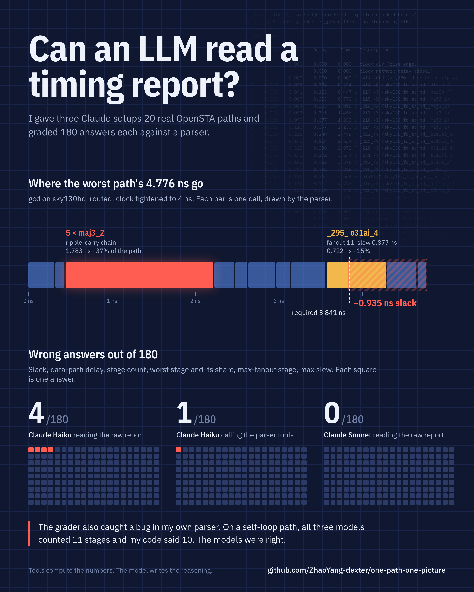
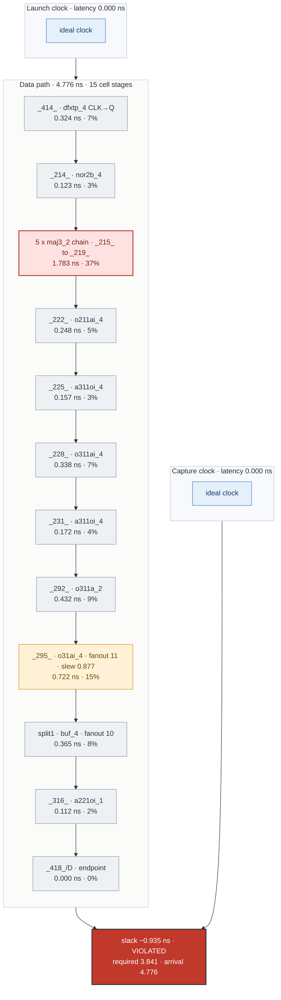
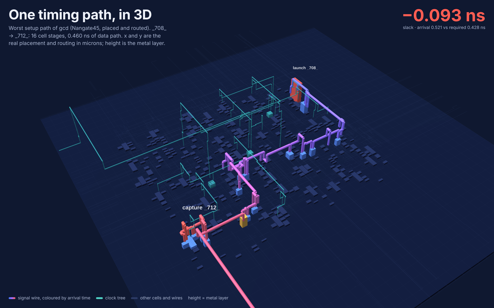

# Can an LLM read a timing report?

Tools for turning OpenSTA timing paths into a verified diagram and a short diagnosis, plus a small
experiment on how well language models read raw `report_checks` output.

The rule this repo follows: **tools compute, the model reasons.** The parser reads every number
from the report, the diagram is generated by code, and the model only writes the explanation.
Every number in that explanation can be checked against the tools.



A more detailed version with the full path diagram: [assets/llm_reads_timing.png](assets/llm_reads_timing.png)

## What is in here

| Part | What it does |
|---|---|
| `stapath/` | Parser for OpenSTA `report_checks -format full_clock_expanded -fields {slew cap fanout}` and a deterministic Mermaid renderer |
| `python3 -m stapath …` | CLI tools: `list`, `summary`, `stages`, `mermaid` |
| `stapath/mcp_server.py` | The same tools as an MCP server (`list_paths`, `path_summary`, `path_stages`, `path_mermaid`) |
| `skills/sta-path-picture/` | A Claude Skill that tells the model to use the tools and how to write the three-sentence diagnosis |
| `flow/` | OpenSTA script that produces every report here from OpenSTA's public gcd example |
| `stapath/defparse.py`, `stapath/path3d.py` | DEF reader and the 3D path view on real placement and routing |
| `designs/gcd_nangate45/` | Placed and routed gcd from OpenROAD's test data, with the scripts that time it |
| `eval/` | 20 real paths, the task, the grader, raw model answers and graded results |
| `PROMPT.md` | The original single-prompt version (v1) |

## Real data

OpenSTA ships a routed `gcd` design on the SkyWater sky130hd library with SPEF parasitics.
`flow/run_sta.tcl` reads it with the example SDC, tightens the clock from 5.0 to 4.0 ns, and dumps:

- `reports/gcd_4ns_top40.rpt`: top 40 endpoints (WNS −0.94 ns, TNS −26.40 ns)
- `reports/gcd_4ns_per_startpoint.rpt`: the worst path from every register and input port

```bash
OPENSTA=/path/to/OpenSTA sta -no_init -exit flow/run_sta.tcl
```

## Worst path, drawn by the tool

`python3 -m stapath mermaid reports/gcd_4ns_top40.rpt --path 0`

The renderer colours each stage by its share of the data-path delay (red ≥ 20%, amber 10–20%) and
collapses runs of three or more identical cells. That collapsing is what exposes this path: no single
cell is above 15%, but the five-cell maj3 ripple-carry chain is 37%.



Diagnosis, written from the tool output:

1. No single cell dominates (the largest, `_295_` o31ai_4, is 0.722 ns or 15% of the 4.776 ns data path), but five back-to-back maj3_2 cells `_215_` to `_219_` form a ripple-carry chain that costs 1.783 ns, 37% of the path.
2. Clocks are ideal in this example, so skew plays no part; the second contributor is `_295_` driving fanout 11 with a 0.877 ns slew, followed by the `split1` buffer at 0.365 ns.
3. Restructure the carry chain first (carry-lookahead or retiming): it targets 1.783 ns against a 0.935 ns violation, while upsizing `_295_` alone can recover at most 0.722 ns.

## The path in 3D, on the real layout



The sky130 example has no placement data, so for this view I used a design that has it: OpenROAD's
own test copy of gcd on Nangate45, **placed and routed** (`designs/gcd_nangate45`, sources listed
there). The netlist is rebuilt from the DEF, wire load comes from the routed length on each layer
times OpenROAD's Nangate45 layer capacitance, and the clock is propagated through the real clock tree.
At 0.40 ns the worst path fails by 0.093 ns.

In the picture, x and y are the real cell positions and wire coordinates in microns, height is the
metal layer, and the signal wire is coloured by arrival time. The view makes one thing obvious that
the text report hides: `_485_` drives a 48.6 µm net that runs all the way to the output pin
`resp_msg[11]` before the path continues to `_712_`.

Open `assets/path3d.html` in a browser to rotate it and hover cells.

```bash
OPENSTA=/path/to/OpenSTA sta -no_init -exit designs/gcd_nangate45/run_sta.tcl
python3 -m stapath.path3d reports/gcd_nangate45_worst.rpt designs/gcd_nangate45/gcd_nangate45_route.def \
    designs/gcd_nangate45/Nangate45.lef path3d.html
python3 tools/render_3d.py path3d.html path3d.png 1600 1000      # static render (headless Chromium)
```

## The experiment

**Question:** if you paste raw timing paths into a model, does it get the numbers right? And does
giving it tools help?

**Setup.** 20 real paths from the gcd reports (`eval/paths.rpt`): violating and passing, register and
output-port endpoints, one self-loop. For each path the model answers 9 fields (`eval/TASK.md`):
slack, data-path delay, cell-stage count, worst stage, its delay and share, max-fanout stage and
fanout, max slew. That is 180 answers per run. `eval/grade.py` grades them against the parser,
accepting ties, and also checks that every number quoted in the free-text diagnosis exists in the
path (after rounding).

| Run | Wrong answers (of 180) | Paths fully correct | Quoted numbers found in the report |
|---|---|---|---|
| Claude Haiku, reads the raw report | 4 | 18 / 20 | 47 / 47 |
| Claude Haiku, calls `stapath list` / `stages` | 1 | 19 / 20 | 39 / 39 |
| Claude Sonnet, reads the raw report | 0 | 20 / 20 | 19 / 20 * |

\* The one miss is an approximate range ("about 0.35–0.4 ns per stage"), not a made-up value.

**What went wrong.** Haiku reading raw text twice picked the launch flop (fanout 3) as the
max-fanout stage instead of `_225_` (fanout 4). Haiku with tools miscounted stages once (13 vs 12).

**What I learned.**

- Current models read clean OpenSTA paths well. I expected more errors than this.
- Tools did not make the model smarter here; they made the output **checkable**. The diagram and
  every number in it come from code, so a reviewer only has to check the reasoning.
- The grader caught a bug in my own parser. On the self-loop path `_418_ → _418_`, my stage counter
  dropped the CLK→Q arc because start and end share a name; all three models said 11 stages and
  they were right. Having a checker pays off in both directions.

**Limits.** One small design, 20 paths, one run per setup, ideal clocks. This is a sanity check,
not a benchmark. Harder cases worth trying next: hundreds of paths in one context, MCMM reports,
propagated clocks with CRPR, and PrimeTime formats.

Reproduce: answers are in `eval/results_*.json`; regrade with

```bash
python3 eval/grade.py eval/paths.rpt eval/results_prompt_only_haiku.json
```

## Use it

```bash
python3 -m stapath list    reports/gcd_4ns_top40.rpt
python3 -m stapath summary reports/gcd_4ns_top40.rpt --path 0
python3 -m stapath stages  reports/gcd_4ns_top40.rpt --path 0
python3 -m stapath mermaid reports/gcd_4ns_top40.rpt --path 0 > path.mmd
```

As an MCP server (Claude Code picks up `.mcp.json` in this folder):

```bash
pip install mcp
python3 -m stapath.mcp_server
```

As a Claude Skill: copy `skills/sta-path-picture/` into your skills folder.

Re-render images: `mmdc` ([mermaid-cli](https://github.com/mermaid-js/mermaid-cli)) for SVG, then
`python3 tools/make_poster.py` and `python3 tools/make_hero.py` (Playwright) for the images. Fonts: IBM Plex (OFL), in `tools/fonts/`.

## v1: one prompt

The first version was a single prompt that asks the model to draw the Mermaid diagram itself
([PROMPT.md](PROMPT.md), example in `examples/setup_violation.*`, image `assets/before_after.png`).
It works, but nothing checks the numbers the model writes, which is what led to v2.

## A note on data

Everything here uses OpenSTA's public example design and the open SkyWater sky130 library. Before
pasting a real report into any hosted model, check your company's policy.

## Credits

[OpenSTA](https://github.com/The-OpenROAD-Project/OpenSTA) (Parallax Software) for the timing engine
and the gcd example; [PathView](https://github.com/kanndil/PathView) for the idea of drawing paths;
the [Timing Analysis Agent](https://arxiv.org/abs/2504.11502) paper (Nainani et al.) for the idea of
letting the model query structured data instead of reading raw reports.

## License

MIT
