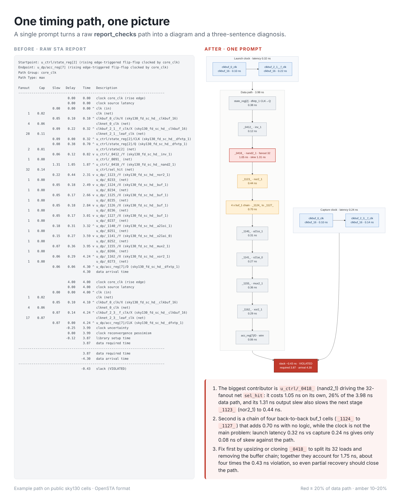
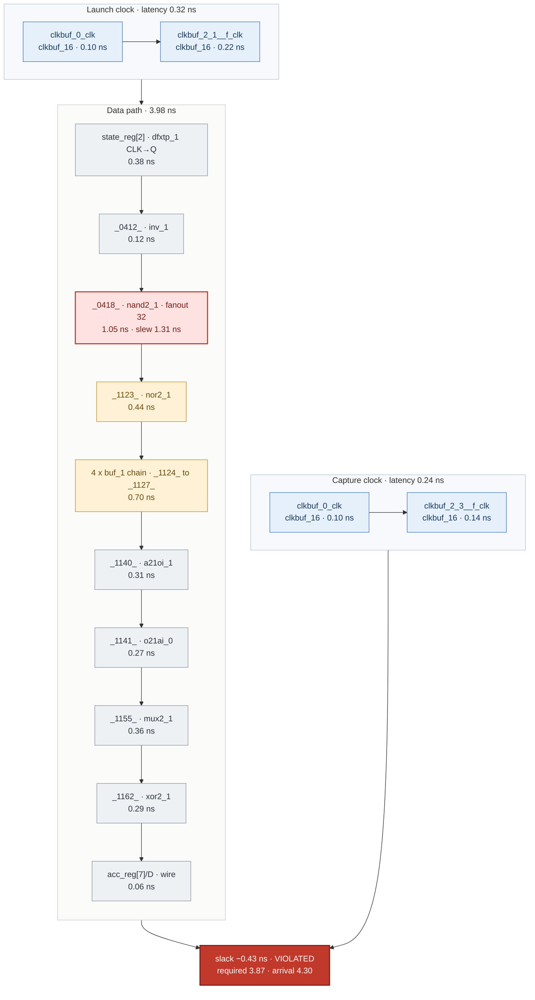

# One timing path, one picture

A single prompt that turns one path from a static timing report into a Mermaid diagram plus a three-sentence diagnosis.

No parser, no framework. Paste the prompt and one path into an LLM, and the colours tell you where the delay went.



## How to use

1. Dump one path from your STA tool, for example in OpenSTA:
   ```tcl
   report_checks -path_delay max -format full_clock_expanded -fields {slew cap fanout}
   ```
   PrimeTime `report_timing -path_type full_clock_expanded -transition_time -capacitance -nets` works too.
2. Copy the prompt from [PROMPT.md](PROMPT.md) and paste the path at the end.
3. Paste the Mermaid block into any Markdown viewer that renders Mermaid (GitHub, GitLab, Obsidian, Notion) or into [mermaid.live](https://mermaid.live).

## Example

Input: [examples/setup_violation.rpt](examples/setup_violation.rpt), a 4 ns setup path on public sky130 cells that misses by 0.43 ns.

Output diagram (GitHub renders this block directly):



Output diagnosis:

1. The biggest contributor is `u_ctrl/_0418_` (nand2_1) driving the 32-fanout net `sel_hit`: it costs 1.05 ns on its own, 26% of the 3.98 ns data path, and its 1.31 ns output slew also slows the next stage `_1123_` (nor2_1) to 0.44 ns.
2. Second is a chain of four back-to-back buf_1 cells (`_1124_` to `_1127_`) that adds 0.70 ns with no logic, while the clock is not the main problem: launch latency 0.32 ns vs capture 0.24 ns gives only 0.08 ns of skew against the path.
3. Fix first by upsizing or cloning `_0418_` to split its 32 loads and removing the buffer chain; together they account for 1.75 ns, about four times the 0.43 ns violation, so even partial recovery should close the path.

## What the prompt enforces

| Rule | Why |
|---|---|
| Three fixed subgraphs: launch clock, data path, capture clock | Every path comes out in the same shape, so pictures can be compared |
| Colour by share of data-path delay (≥ 20% red, 10–20% amber) | The hot spot stands out on fast and slow paths alike |
| Collapse 3+ back-to-back buffers into one node | A buffer chain shows up as one obvious block |
| Only numbers from the report, or sums of them | Stops the model from rounding or making up delays |
| Exactly three sentences with fixed roles | Biggest contributor, clock check, first fix |

## Files

```
PROMPT.md                              the prompt
examples/setup_violation.rpt           input path (OpenSTA format, sky130 cells)
examples/setup_violation.mmd           Mermaid output
examples/setup_violation_diagnosis.md  three-sentence output
assets/before_after.png                comparison image
tools/make_compare.py                  builds the comparison image (Playwright)
```

Re-render the diagram locally with [mermaid-cli](https://github.com/mermaid-js/mermaid-cli):

```bash
mmdc -i examples/setup_violation.mmd -o examples/setup_violation.svg
python3 tools/make_compare.py examples/setup_violation.rpt examples/setup_violation.svg \
    examples/setup_violation_diagnosis.md assets/before_after.png
```

## A note on data

The example uses public SkyWater sky130 cell names in OpenSTA format. Before pasting a real report into any hosted model, check your company's policy and strip instance and library names if needed.

## Inspired by

[PathView](https://github.com/kanndil/PathView), which renders OpenSTA and PrimeTime paths as schematics. This project tries the same idea with one prompt instead of a tool.

## License

MIT
